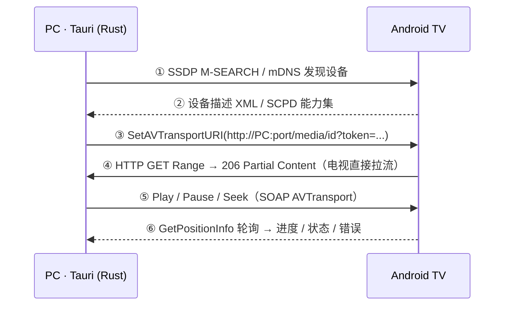

# dbhx-player · 任务交接文档

| 项 | 内容 |
|---|---|
| 项目名 | dbhx-player（暂定，未最终命名） |
| 项目根目录 | `E:\my-git\dbhx-player` |
| 文档生成日期 | 2026-11-06（13:40 更新决策状态） |
| 当前阶段 | **方案与关键决策已书面确认**；`DESIGN.md` 工程设计待最后确认，未建立工程、未写业务代码 |
| 当前阻塞点 | 仅剩「工程结构与接口设计」一道确认；授权阻塞已于 13:40 解除 |
| 仓库状态 | git 已 init，master 分支，`No commits yet`，无 `.gitignore`；新增 `PLAN.md`、`DESIGN.md` 未提交 |

---

## 0. 一句话现状

要做一个 **PC 端跨平台（macOS / Windows / Linux）的视频播放器**，体验参考 macOS 的 IINA，支持**投屏到安卓电视**；技术栈已锁定为 **Rust + Tauri 2.12 + Vue 3 + Ant Design Vue + Pinia**。架构方案、技术调研、界面示意图均已完成并核实。用户已于 2026-11-06 13:40 书面确认 **A（GPL 构建 + 项目开源）** 与 **P0 先行**，其余 5 项按 `PLAN.md` §6.2 默认值执行；按「再确认一次」的工作约定，实施前仍需确认 `DESIGN.md`，之后才进入 P0 Spike。

---

## 1. 需求与范围

### 1.1 已锁定（用户输入，不要重新讨论）

| # | 约束 | 说明 |
|---|---|---|
| 1 | 视频播放软件 | 桌面播放器，体验参照 IINA |
| 2 | 投屏到安卓电视 | Android TV / 国产智能电视 / 盒子 |
| 3 | 跨平台 | 用户明确收敛为 **只做 PC 端**：macOS / Windows / Linux |
| 4 | **不做** iOS / Android 移动端 | 此约束消除了 libmpv 移动端不可行的最大风险 |
| 5 | 播放器参考 IINA | 深色极简、悬浮控制条、全格式、原生质感 |
| 6 | 技术栈 | Rust + Tauri 2.12 + Vue 3 + Ant Design Vue + Pinia |

### 1.2 方案演进（避免重复讨论）

| 阶段 | 结论 | 状态 |
|---|---|---|
| 初版泛化方案 | 控制端曾建议 Flutter + 移动端原生播放内核，TV 端 Kotlin + Media3 | **已废弃**：用户指定了 Tauri/Vue 栈 |
| 第二版 | 换为 Tauri 2.12 + Vue 3 + libmpv，TV 端仍原生 | 部分保留 |
| 第三版（当前） | 范围收敛到 PC 端，移动端风险全部移除，PC 侧新增可实时转码的优势 | **当前有效** |

TV 端始终是 **Kotlin 原生**（不跟着跨端），因为 Android TV 的遥控器焦点、10-foot UX、MediaSession、Widevine 都要原生能力。

---

## 2. 技术栈定稿

| 层 | 选型 | 要点 |
|---|---|---|
| UI | Vue 3 + Ant Design Vue + Pinia | 透明 Overlay 覆盖在视频层上；暗色 token 对齐 IINA 深色模式 |
| 应用壳 | **Tauri 2.12.x** | Commands + Events 双向绑定 Pinia；2.12.1 起 macOS 透明窗口免 `macos-private-api` |
| 播放内核 | **libmpv 0.41**（`tauri-plugin-libmpv` 或自研 plugin） | 原生 video surface + 透明窗口；**WebView 只做 UI，不负责解码** |
| Rust core | tokio + axum + `vuio-core` + redb / SQLite | SSDP/mDNS 发现、DLNA 控制、媒体索引、播放历史 |
| 媒体服务 | axum **HTTP 206 Range** | 本地文件 / 外挂字幕 / token 化 URL |
| TV 端 | 内置 DLNA 接收端（P2）→ 可选 Kotlin + Media3 1.11.1 + Compose for TV（P3） | 原生，不跨端 |

---

## 3. 已核实事实（证据链，核实于 2026-11-06）

> 以下结论均来自当次联网检索，附录 A 有链接。接手时若时间较久，建议复核版本号。

### 3.1 Tauri

- **Tauri 2.12 真实存在**：2.12.0 发布于 2026-09-26，最新 2.12.3 于 2026-10-10。
- 2.12 是 2.x 迄今最大更新：**MSRV 提到 1.90**、**放弃 Windows 7 官方支持**、Android 模板升级到 Gradle 9 + Kotlin 2 + targetSdk 37。
- **关键利好**：2.12.1 起，macOS 使用透明窗口 / 全屏**不再需要** `macos-private-api` feature 或 `macOSPrivateAPI` 配置 —— libmpv 嵌入恰好依赖透明窗口。
- Tauri 2 官方支持 iOS/Android，但移动端支持较新；本项目已明确不做移动端，无需评估。

### 3.2 IINA 与播放内核

- IINA = **Swift / AppKit UI + libmpv 内核**，**GPLv3**；1.5.0（2026-10）重做界面、加入插件商店 / Live Text，mpv 升至 0.41.0。
- 其架构本质是「**原生渲染 surface + 上层 UI 覆盖**」，不是 WebView 播视频。
- **系统 WebView 不能承担解码**：MKV / HEVC / AV1 / 4K HDR / FLAC 覆盖不了，达不到 IINA 的"全格式"。
- 桌面端 libmpv 嵌入有现成路径：
  - `tauri-plugin-libmpv`：需 `libmpv-wrapper` + 平台 libmpv 动态库 + `transparent: true` + `resources: lib/**/*`。
  - **OpenPlayer**（Tauri v2 + Rust + React + libmpv）：video host + transparent overlay 双窗口，是目前最贴近 IINA 形态的参考实现。
  - **MaxVideoPlayer**：自定义 `tauri-plugin-mpv`，macOS 用 NSOpenGLView、Linux 用 EGL + X11/Wayland。
- **授权风险（见第 8 节）**：IINA 是 GPLv3，mpv 默认 GPL，但存在 **LGPL 构建**（如 `mpv-dev-lgpl`）。

### 3.3 投屏协议与 Rust 生态

- 国内 Android TV / 盒子出厂**普遍内置 DLNA/UPnP 接收端**。
- **Android TV 的 Google Cast 接收端是 GMS 闭源组件，没有可替代的开源实现，国内基本没有** → Google Cast 不能做国内主通道。
- DLNA 是「**推播放地址 + 控制指令**」，电视自行拉流，不是画面镜像。投本地文件时，PC 必须常驻支持 **HTTP Range(206)** 的服务，否则电视无法拖动进度。
- **`vuio-core`（Apache-2.0）**：可嵌入进程的 Rust runtime，自带 SSDP、mDNS/DNS-SD、UPnP ContentDirectory、**HTTP Range 流式传输**、DLNA/Chromecast/AirPlay renderer 控制、管理 API。投屏侧工作量可大幅复用。
- VuIO 项目明确说明：**macOS 上 Docker 因组播限制不可用**。若以后要把媒体服务放到 NAS/容器，只能原生部署或换宿主。
- 常见发现失败原因：AP/客户端隔离、2.4G/5G 分频、访客网络、防火墙拦截 SSDP 组播 → 必须提供**手动输入 IP** 兜底。

### 3.4 TV 端

- **Media3 1.11.1**（2026-10-26 稳定），含 `media3-exoplayer` / `-hls` / `-dash` / `-session` / `-cast` / `-ui-compose` / `-ui-leanback`。
- 现行 TV UI 路径是 **Compose for TV**（`androidx.tv:tv-material`），替代旧 Leanback fragments；注意不要混用 `androidx.compose.material3.*` 与 `androidx.tv.material3.*`。
- Android TV 必须声明 `LEANBACK_LAUNCHER` intent filter、`android.software.leanback` 非必需。
- **2026-08-01 起**，Google Play 上含 native code 的 Google TV / Android TV 应用强制 64-bit；target API 35+ 还需适配 16 KB page size。纯 Kotlin + Media3 不受影响，**引入 VLC / ijkplayer / FFmpeg 会中招**。
- Widevine L1 在现代 Android TV 上普遍可用。

---

## 4. 架构设计结论

### 4.1 分层

```
┌─ Tauri 2.12 应用（PC 三端）────────────────────────────┐
│  Vue 3 + Ant Design Vue + Pinia   ← 透明 Overlay        │
│    · 控制条 / 播放列表 / 设置 / 深色主题                  │
│  Tauri IPC · Commands + Events    ← Pinia store 订阅     │
│  Rust Core                                             │
│    · MpvEngine（libmpv 原生 surface）                   │
│    · CastController（SSDP / mDNS / DLNA，vuio-core）     │
│    · axum MediaServer（HTTP 206 Range，token 化 URL）    │
└──────────────┬─────────────────────────────────────────┘
               │ 局域网：控制指令 / 状态回传 / 媒体流
┌──────────────▼─────────────────────────────────────────┐
│  Android TV                                            │
│    · 内置 DLNA 接收端（零安装，P2 主通道）                │
│    · 可选自建 Receiver：Kotlin + Media3 + Compose for TV  │
│    · ExoPlayer 拉流 / MediaSession / 遥控器 DPad          │
└────────────────────────────────────────────────────────┘
```

**协议层先抽 `CastTransport`**（`discover` / `load` / `control` / `stateStream`），P2 只落 DLNA 实现，日后接自建 Receiver 不返工。这是"最小改动 + 可逆加固"的做法。

### 4.2 投屏一次会话的时序（核心机制）



**第 ④ 步是技术命门**：本地文件不能推路径，必须由 PC 起支持 `Range` / `206` / `Content-Range` 的 HTTP 服务，电视端自己拉流。缺了它进度条能显示但一拖就断。`vuio-core` 已内置，不必从零写。

### 4.3 投屏路线 trade-off

| 路线 | TV 端安装 | 覆盖 | 能力上限 | 工作量 | 判断 |
|---|---|---|---|---|---|
| **A. DLNA / UPnP** | 零安装 | 国产电视/盒子最广 | 只能推 URL；状态靠 `GetPositionInfo` 轮询；字幕/音轨/清晰度/自有 UI 受限；厂商 SOAP 实现有差异 | 小，`vuio-core` 覆盖大半 | **P2 主推**，最快验证 |
| **B. 自建 Receiver**（Kotlin + Media3 + NSD/WebSocket） | 需侧载 APK | 仅装了 App 的电视 | 完整：自有 UI、进度双向同步、字幕、播放列表、PIN 配对、Widevine | 大，多一个 TV 工程 | P3，要产品化才做 |
| C. Google Cast | 需 GMS | **国内基本没有** | 强，但需 Cast Developer ID + 发布 Web Receiver | — | **排除** |
| D. Miracast / 镜像 | — | — | 画质差、延迟高、PC 需常亮 | — | **排除**，不适合纯视频播放 |

### 4.4 IINA 特性对照（可落地部分）

| IINA 特性 | 本方案落地方式 | 判断 |
|---|---|---|
| 全格式 / libmpv 内核 | libmpv 0.41 + 原生 surface | ✅ 桌面三端 |
| 现代 UI、深色模式、悬浮控制条 | Vue 3 + Ant Design Vue + 自动隐藏逻辑 | ✅ |
| 音轨 / 字幕轨 / 倍速 / 逐帧 / AB 循环 / 截图 / 滤镜 | mpv property 直接透传 | ✅ 几乎零成本 |
| `mpv.conf` / `input.conf` / Lua 脚本 | 配置透传 | ✅ |
| 播放列表 / 历史 / 断点续播 / 音乐模式 | Pinia + redb，布局切换 | ✅ |
| 插件系统（IINA 1.5 插件商店） | JS 插件 + Tauri 权限白名单 | ✅ 比 IINA 更好落 |
| 在线字幕 | Rust 侧字幕源客户端 | ✅ P4 |
| 缩略图进度条 | ffprobe / ffmpeg 抽帧 | ⚠️ 引入额外依赖与授权 |
| 原生画中画 | macOS 需 Swift 扩展 / Win 置顶无边框窗 / Linux 类似 | ⚠️ 逐平台做 |
| Touch Bar / Force Touch / Live Text | 平台专属 | ⚠️ 建议不做 |

---

## 5. 三平台差异与已知坑

| 项 | macOS | Windows | Linux |
|---|---|---|---|
| WebView | WKWebView | WebView2 | WebKitGTK 4.1 |
| libmpv 渲染 | NSOpenGLView / Metal；**Homebrew 的 mpv 是 Vulkan-only，嵌入需源码编译**（mpv 0.40/0.41 与 ffmpeg 8 不兼容，需 ffmpeg@7） | D3D11 / 原生 HWND；用 `mpv-dev-lgpl` 预编译 | EGL + X11 子窗口 / Wayland subsurface |
| 透明窗口 | 2.12.1+ 免 private API ✅ | `transparent: true` | 依赖 compositor |
| 打包 | `dylibbundler` 处理 dylib + 签名公证 | DLL 随 `resources: lib/**/*` + MSVC 运行库 | AppImage 需 `patchelf`、系统 `libmpv-dev` |
| 系统门槛 | macOS 12+ | Win10+（2.12 起弃 Win7） | 发行版依赖 |

**通用坑清单**

1. SSDP 组播被防火墙拦（三平台首次运行都会弹），VuIO 的平台检测逻辑可参照。
2. 2.4G/5G 隔离、AP 隔离 → 提供手动输入 IP 兜底。
3. 本地 HTTP 服务的 URL 需 **token 化**，防局域网嗅探；`Range` / `Content-Range` / `Accept-Ranges` / MIME 必须正确。
4. DLNA 状态只能轮询（约 1s），各厂商 SOAP 实现有差异 → 需建立设备兼容表。
5. PC 睡眠 / 换网 → 重连与断点续播。
6. TV 芯片不一定支持 HEVC / AV1 / DTS → 能力探测 + 可选 **PC 侧实时转码**（PC 端独有的补救手段，手机端做不到）。
7. 投屏期间 PC 作为媒体源，需保证服务常驻；但 PC 端没有移动端 Doze 限制，风险低。

---

## 6. 分期计划

| 阶段 | 目标 | 验收标准 |
|---|---|---|
| **P0 Spike（最高风险先行）** | ① 三平台各跑通 Tauri 2.12 + libmpv 透明窗口 + Vue overlay 控制；② 真机 Android TV 上 DLNA 推本地 HTTP 206 URL 能播且能拖进度 | 两条链路各自跑通，否则架构不成立 |
| P1 播放器 MVP | IINA 核心子集：播放列表、字幕/音轨、倍速/逐帧、快捷键、历史、深色主题 | 桌面三端可日常使用 |
| P2 投屏 MVP | 发现 → 推 URL → 播控 → 状态轮询 + 遥控器面板 | 零安装在国产电视投本地文件成功 |
| P3 自建 Receiver（可选） | Kotlin + Media3 + Compose for TV，双向状态、字幕、配对 | 取决于决策 2 |
| P4 深化 | 插件系统、缩略图、在线字幕、转码、PiP | 按优先级裁剪 |

---

## 7. 决策状态（原 7 项，已于 13:40 拍板）

> **✅ 已书面确认（2026-11-06 13:40）**：决策 1 = **A · 直接用 GPL 构建、项目开源**；P0 Spike **允许先行**；决策 2~6 按 `PLAN.md` §6.2 默认值执行；决策 7 由 P0 Spike 给出结论。许可证版本定为 `GPL-3.0-or-later`（mpv 为 GPLv2+ 可升 v3；`vuio-core` Apache-2.0、Tauri MIT/Apache-2.0 与 GPLv3 兼容、与 GPLv2-only 不兼容）。授权核对不再是 P0 前置条件。
>
> **当前唯一待确认**：`DESIGN.md`（工程结构与接口设计）。按工作约定，确认后才建工程、写业务代码、执行 P0。下表保留为决策过程记录。

| # | 决策 | 选项 | 助手倾向 | 影响 |
|---|---|---|---|---|
| 1 | 开源 or 闭源商用 | GPL 开源 / 闭源 | **必须先定** | IINA 是 GPLv3、mpv 默认 GPL；闭源须用 **LGPL 构建（`mpv-dev-lgpl`）+ 动态链接**，否则整个应用被传染，或换内核 |
| 2 | 投屏主通道 | A 纯 DLNA / B 自建 / C 双通道 | C，但 P2 只落 A | 决定是否长期维护 TV 端 Kotlin 工程 |
| 3 | TV 端能否装 APK | 能 / 不能 | 待定 | 不能 → 只能 A |
| 4 | 媒体源 | 本地文件 / 网络流 / 两者 | 两者 | 影响 MediaServer 与鉴权设计 |
| 5 | IINA 特性范围 | 全量对标 / 核心子集 | 核心子集（P1 那批） | 缩略图/插件/PiP 会引入 ffmpeg 与平台原生代码 |
| 6 | 是否要实时转码 | 要 / 不要 | 不要，P4 再说 | PC 有算力，但叠加 ffmpeg 依赖与授权复杂度 |
| 7 | libmpv 接入方式 | 现成插件 / 自研 plugin | 先试插件，P0 验证 | 自研可控但工作量大 |

---

## 8. 未决风险

| 风险 | 等级 | 说明 / 缓解 |
|---|---|---|
| **libmpv 授权** | 高 → **中（已解除阻塞）** | 决策 1 已定 A（GPL 构建 + 项目开源），许可证 `GPL-3.0-or-later`；风险转为 6 条开源合规清单动作（`DESIGN.md` §1）。IINA 仅作视觉参考、不复制源码，不构成传染 |
| **P0 双链路验证** | 高 | 透明窗口嵌 libmpv、真机 DLNA 推本地 206 流，任一不通架构即需调整；必须最先做 |
| DLNA 厂商碎片化 | 中 | SOAP 实现差异、状态轮询延迟 → 设备兼容表 + 手动 IP 兜底 |
| 三平台打包分发 | 中 | dylib/DLL/so 随 bundle、macOS 签名公证、Windows SmartScreen、Linux AppImage |
| macOS Docker 组播 | 低 | 未来若容器化部署媒体服务需换宿主 |

---

## 9. 已有产物与仓库现状

| 路径 | 说明 |
|---|---|
| `player-ui-mockup.html` | **界面示意图**，单文件 HTML、无外部依赖，31,111 字节，sha256 `dad570798921f59fa6ae9477eac9ccd70b339a3996e24f41f582874f22f37bfd` |
| `HANDOVER.md` | 本文档（交接 / 证据链） |
| `PLAN.md` | 方案 v2，决策用主文档（2026-11-06 11:35） |
| `DESIGN.md` | 工程结构与接口设计，实施前最后一份设计（2026-11-06 13:40） |
| `.git/` | master 分支，无任何提交 |

**示意图说明**（浏览器直接打开即可）：
- IINA 式深色播放器窗口：内联 SVG 夜景作视频画面占位 + 字幕渲染、悬浮 OSC 控制条（进度/缓冲/缩略图预览/倍速/字幕/音轨/PiP/全屏）、可折叠播放列表侧栏、投屏面板。
- 可交互：投屏状态三态（本地播放 / 发现设备 / 投屏中）、三平台窗口控件（macOS 红黄绿点 / Windows / Linux）、播放暂停、进度条点击、播放列表切换、设备连接与断开。
- 设计意图：体现「libmpv 原生视频层 + Vue 透明 Overlay」分层、DLNA 零安装发现 + 手动 IP 兜底、投屏后 PC 转为遥控器。
- 窗口下方 ① ~ ④ 编号卡片对应四个区块的技术映射说明。

**git 状态**（2026-11-06 13:40）：`?? .workbuddy/`、`?? HANDOVER.md`、`?? PLAN.md`、`?? DESIGN.md`、`?? player-ui-mockup.html`，均未提交；仓库**尚无 `.gitignore`**、仍为 `No commits yet`。

> **关于 `.workbuddy/`**：这是 WorkBuddy 宿主自动创建的项目数据目录（**不是临时缓存，不要删除**）。其中 `imported-tasks/2026-11-06-cast-player/TASK.md` 是会话导入时自动生成的任务卡，内容与本文档第 1~6 节高度重合；同目录另有 `conversation-data.json`（完整会话归档）与 `share-shell.html`。
>
> **两者定位区别**：`TASK.md` 是**会话快照**（原始对话与需求原文），`HANDOVER.md` 是**面向接手者的正式交接文档**（含决策阻塞点、风险清单、工作约定、参考链接、仓库现状）。建议把 `.workbuddy/` 写进 `.gitignore`，避免把会话数据提交进代码仓库。

---

## 10. 工作约定（接手必读）

1. **先出方案 / 对比表 → 用户书面确认 → 才实施**。方案确认前不建工程、不写业务代码；即使是已确认过的方案，重新生效前也需再次确认。
2. 执行前给**多选项 + trade-off 表格**；重大或不可逆操作必须再确认。
3. 倾向**最小改动、可逆加固、复用现成接口**，主动剔除冗余设计；倾向"不会遗忘"的设计（自描述接口而非外部配置）。
4. 重大/不可逆操作先警告、列清单、要显式确认；优先小步、可回退。
5. git：习惯拆分多个逻辑清晰的提交（记忆文档与代码修复分开），常委托助手代为创建 commit；不擅自提交。
6. 沟通：中文回复，技术术语保留英文；偏好结构化、表格化、详细输出；习惯用 `@file:line` 引用代码位置下达指令。
7. 调试：常用 `@long-text:` 前缀粘贴完整堆栈/日志，期望「根因（含证据链）→ 方案对比 → 确认 → 执行」的节奏。
8. 设计审美：深色主题、响应式布局、极简优雅（本项目以 IINA 为准）。

---

## 11. 下一步（按顺序）

1. **等用户确认 `DESIGN.md`**（工程结构与接口设计），或直接回复「按此开工」。
2. 确认后 P0 第一步：补 `.gitignore`（含 `.workbuddy/`）+ 首次提交（示意图、`PLAN.md`、`DESIGN.md`、本文档）。
3. 按 S1→S5 执行 **P0 Spike**：先打通三平台 libmpv 透明窗口与真机 DLNA 206 推流两条最高风险链路；S1 先出 Windows 结果，macOS / Linux 走 CI 构建矩阵，视觉验收留真机。
4. P0 结束按 4 条 Go/No-Go 判定项决定进入 P1 或调整架构（`PLAN.md` §4、`DESIGN.md` §8）。
5. 每完成一个阶段，回来更新本文档第 6 / 7 / 9 节状态。

---

## 附录 A · 参考链接（2026-11-06 核实）

| 主题 | 链接 |
|---|---|
| Tauri 2.12 发布公告 | https://v2.tauri.app/zh-cn/blog/tauri-2.12/ |
| Tauri API 全版本 changelog | https://tauri.app/release/@tauri-apps/api/all-versions |
| Tauri 2 官网（跨平台说明） | https://www.tauri.net.cn/ |
| IINA 官网 | https://iina.io |
| IINA 架构/授权概览 | https://www.opensourcefeed.org/software/iina/ |
| OpenPlayer（Tauri v2 + libmpv 参考实现） | https://github.com/AreChen/OpenPlayer |
| MaxVideoPlayer（自定义 tauri-plugin-mpv） | https://github.com/MaxMB15/MaxVideoPlayer |
| tauri-plugin-libmpv | https://lib.rs/crates/tauri-plugin-libmpv |
| vuio-core（可嵌入 DLNA runtime） | https://crates.io/crates/vuio-core |
| VuIO Media Server | https://github.com/vuiodev/vuio |
| Media3 版本页 | https://developer.android.google.cn/jetpack/androidx/releases/media3 |
| Smart TV Players 2026（64-bit / 16KB / DRM） | https://www.forasoft.com/learn/video-streaming/articles-streaming/smart-tv-players-tizen-webos-roku-vidaa |
| Android 13 `NEARBY_WIFI_DEVICES` 行为变更 | https://developer.android.com/about/versions/13/behavior-changes-13 |
| 国内 Android TV 投屏协议综述 | https://www.heishou.org/d/479142 |

## 附录 B · 关联记忆位置

工作区记忆（WorkBuddy 会话工作区，非项目目录）：
- `C:\Users\lzdbh\WorkBuddy\2026-11-06-11-01-17\.workbuddy\memory\2026-11-06.md`（当日完整调研记录）
- `C:\Users\lzdbh\WorkBuddy\2026-11-06-11-01-17\.workbuddy\memory\MEMORY.md`（项目长期约定，含项目根路径）
